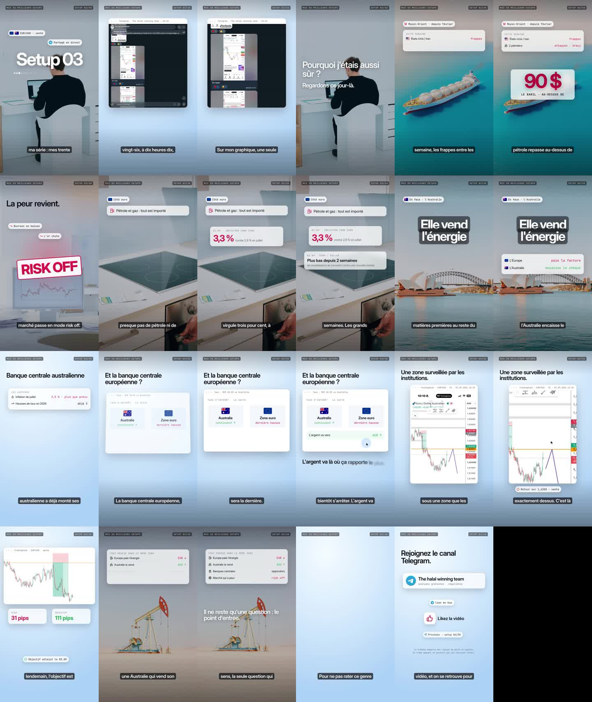

# Octobre 2026 (02/10 - 14/10) : messages, captures, vidéos et stratégie d'Amirou

*Rédigé le 14/10/2026. Source : export `ChatExport_2026-10-14` (messages #15536 à #15629). Rejeu des trades : [`scripts/verifier_octobre_2026.py`](../scripts/verifier_octobre_2026.py) → [`data/octobre_2026/trades.csv`](../data/octobre_2026/trades.csv). Transcription des vidéos (faster-whisper, modèle « small ») : [`data/octobre_2026/transcriptions_videos.txt`](../data/octobre_2026/transcriptions_videos.txt).*

## 1. Ce que contient la période

- **92 messages**, 26 photos, 9 liens TradingView, 2 vidéos (#15609 et #15619).
- **Moins de la moitié des messages parlent de trades.** Le reste est commercial :
  - le livre *Le Forex sans illusion* (12 500 F, puis 17 500 F après la précommande, #15551-#15552) ;
  - la formation débutant (150 000 F, #15553) et la masterclass (600 000 F en trois versements, #15554) ;
  - l'abonnement SignalX (#15579) et un bot de validation de comptes One Step Pro chez OPF Capital (#15568, #15587) ;
  - une série TikTok des « 30 meilleurs setups » (#15616-#15619) et une session gratuite au bureau le 17/10 (#15601).
- La fiche de la formation (#15589) liste au module 7 « Stratégies : Bomb & CBO ».

## 2. Les trades publiés

| Message | Paire | Plan (entrée / stop / objectif, ratio) | Publié | Statut dans le canal | Selon les cours (horaire) |
|---|---|---|---|---|---|
| #15541 | EURAUD vente | 1.62505 / 1.62912 / 1.61567 (2,3) | 02/10 12h21, prix déjà à 1.6171 | ⚠️ après coup (entrée le 01/10) | objectif atteint le 02/10 |
| #15547-#15549 | USDJPY achat | 157.503 / 157.202 / 158.106 (2,0) | 02/10 16h34, prix à 157.89 | ⚠️ après coup ; MT5 : 2,65 lots, +694,77 $ | objectif atteint le 05/10 |
| #15544 | GBPUSD | « fermer si vous êtes dans le trade » | 02/10 13h23 | ❔ plan jamais montré (pris pendant le live du NFP) | — |
| #15560-#15563 | EURGBP vente limite | 0.85000 / 0.85149 / 0.84694 (2,1) | 05/10 01h22, « setup A+ donc 90 % de probabilité » | ⏸ non déclenché (« dommage », #15563, #15581) | non déclenché ; le prix est allé à l'objectif sans passer par l'entrée |
| #15565 | EURNZD vente | 2.00217 / 2.00723 / 1.99063 (2,3), « 0,5 % de risque » | 05/10 14h19, au prix d'entrée | annoncé | ✅ objectif atteint le 14/10 (+2,3 R), 9 jours plus tard |
| #15569 | Dow Jones (US30) vente | 51 121,6 / 51 294,4 / 50 582,6 (3,1) | 05/10 14h52 | annoncé | ❔ pas de cours de l'indice dans le projet |
| #15576-#15578, #15584 | EURUSD vente | 1.12509 / 1.12766 / 1.11998 (2,0) | 07/10 07h30, prix à 1.1216 | ⚠️ après coup ; « 1 % », passage à BE ; MT5 : 2,8 lots | objectif atteint le 07/10 |
| #15591, #15598 | GBPAUD vente | 1.90001 / 1.90414 / 1.89069 (2,3) | 09/10 15h50 (récapitulatif) | ⚠️ après coup (partagé sur SignalX) | objectif atteint le 14/10 |
| #15594, #15597 | EURNZD vente | 1.99982 / 2.00332 / 1.99235 (2,1) | 09/10 15h50 (récapitulatif) | ⚠️ après coup | objectif atteint le 13/10 |
| #15595-#15596 | Or achat | 4 125,15 / 4 106,16 / 4 172,20 (2,5) | 09/10 15h50, « TP HIT » | ⚠️ après coup | objectif atteint le 09/10 |
| #15615 | GBPUSD vente | 1.32371, stop au point mort | 12/10 18h38, MT5 : 1,66 lot, +529,54 $ | ⚠️ après coup, sans objectif | — |
| #15620-#15623 | EURUSD vente | 1.11923 / 1.12279 / 1.11032 (2,5) | 14/10 12h33, juste après la chute de 12h30 ; plan créé le 13/10 13h55 (SignalX) | ⚠️ après coup dans le canal ; MT5 : 1,43 lot, +549,12 $ | en cours au 14/10 au soir (+1,4 R) |
| #15624-#15628 | GBPJPY vente limite | 209.997 (« MLQ à 210.000 ») / 210.244 / 209.455 (2,2) | 14/10 12h40 | ⏸ non déclenché (« le trade est parti sans nous ») | non déclenché ; objectif atteint sans entrée |

**Bilan** :
- **Trois plans seulement sont publiés dans le canal gratuit avant l'entrée** : deux ordres limites jamais déclenchés (EURGBP, GBPJPY) et une vente EURNZD gagnante après 9 jours (+2,3 R).
- **Huit plans sont montrés après coup**, presque tous gagnants. Ce sont les trades de SignalX, l'abonnement payant, republiés en récapitulatif (« SignalX était en feu ces 4 dernières semaines », #15590). Aucune perte n'est montrée sur la période.
- **Les positions MT5 sont grosses** : de 1,43 à 2,8 lots, avec des gains de 529 à 695 $ affichés.

## 3. Les vidéos

**#15619, « Setup 3 » de la série TikTok (EURAUD, 2 min 20)**. Amirou raconte une vente EURAUD de septembre :
- **Le récit** : guerre au Moyen-Orient, pétrole au-dessus de 90 $, marché en *risk off* ; l'Europe importe son énergie (inflation à 3,3 %), l'Australie l'exporte ; la RBA monte ses taux, la BCE va faire sa « dernière hausse » ; « l'argent va là où ça rapporte le plus ».
- **L'entrée** : « Mon entrée est discrétionnaire. Une semaine plus tôt, le prix avait cassé sous une zone que les institutions surveillaient. Autour de 1,625. Ce matin-là, il remonte exactement dessus. C'est là que je place ma vente. Stop à 31 pips, objectif à 111. »
- **Vérification** :
  - **Taux** : la RBA est passée de 3,60 % à 4,35 % en trois hausses en 2026 (février, mars, mai), et la BCE de 2,25 % à 2,50 % en septembre (données BIS). Le récit des banques centrales est exact.
  - **Date** : le « En route » du canal date du **01/09 à 10h10** (#15284 est un transfert, le 02/09, d'un message du 01/09). La vidéo dit « le 2 septembre à 10h10 ». À 10h10 le 01/09, le prix était à 1,6229 et la capture ne montre qu'une flèche, pas d'ordre.
  - **Niveaux** : le plan publié dans le canal (#15286, TradingView créé le 01/09 à 21h40, posté le 02/09 à 12h29 sous le titre « Avant », quand le prix avait déjà baissé) est : vente 1,62500, **stop 1,63003 (50 pips), objectif 1,61470 (103 pips), ratio 2,1**. La vidéo annonce un stop de 31 pips et un objectif de 111 pips, soit « plus de trois fois et demie le risque ».
  - **Cours** : le 02/09 vers 10h, le prix est monté à 1,6246, à 4 pips de l'entrée, puis l'objectif a été atteint le 03/09. Le trade a bien fonctionné **si l'ordre a été exécuté à 1,6250**, mais avec un ratio de 2,1, pas de 3,6.
  - Dans la vérification de septembre, ce trade est classé ⚠️ (publié après coup dans le canal).
- 

**#15609, bande-annonce du livre (50 s, sans parole)** : l'abandon du plancher EUR/CHF le 15/01/2015 (+30 %), le Brexit le 23/06/2016 (−10 % en une nuit), puis « Un narratif n'est ni vrai ni faux. C'est une croyance partagée. Et elle fait bouger les prix », avec un cycle « murmure, accélération, saturation, fissure ».

**Vidéos de septembre** (#15456, #15457, extraits d'un appel, son de mauvaise qualité) : Amirou y explique que l'attention du marché (la politique, la prime de risque) peut primer sur une hausse de taux, et qu'il faut se repositionner « dès que le sentiment change ».

## 4. La stratégie d'Amirou en octobre

Les messages, les captures et les vidéos montrent la même méthode, cohérente avec le chapitre 19 du livre (« Comprendre le narratif », #15586) :

1. **Le narratif fondamental décide du sens.**
   - Euro « structurellement faible » (énergie, BCE en fin de hausses) : EURUSD, EURAUD, EURNZD, EURGBP vendus.
   - Dollar porté par les taux américains : la capture #15546 compare le rendement américain à 2 ans (rebond sur 4,715 %) et EURUSD.
   - Yen acheté par crainte d'une intervention de la BOJ près de 160 (#15625).
   - Lecture en direct de la réaction aux chiffres : live du NFP le 02/10, sortie de GBPUSD et achat d'USDJPY « dès que le sentiment a changé » (#15544, #15547).
2. **L'entrée se fait sur un niveau rond, au retour du prix après une cassure.** Presque toutes les entrées d'octobre sont sur un MLQ (multiple de 250 pips) ou un niveau rond :
   - 1,6250 (EURAUD), 157,50 (USDJPY), 0,8500 (EURGBP), 2,0000 (EURNZD), 1,1250 (EURUSD), 1,9000 (GBPAUD) ;
   - 210,000 (GBPJPY, annoté « MLQ à 210.000 ») ;
   - et 50 000 sur le Dow comme repère.
   - Le scénario dessiné est toujours le même : le prix a cassé le niveau, revient le tester, puis repart (zigzag violet sur les captures #15591, #15594, #15624).
   - Ordre limite posé à l'avance sur le niveau. S'il n'est pas touché, le trade est abandonné (« dommage »).
3. **Le risque.**
   - Stop de 15 à 50 pips au-delà du niveau, objectif à 2-2,5 R vers le niveau suivant (souvent un autre niveau rond : 1,1200, 1,6150, 1,8900).
   - Risque annoncé de 0,5 à 1 %, passage rapide au point mort (EURUSD le 07/10, GBPUSD le 12/10, EURUSD le 14/10).
   - Mais, d'après #15586, la taille augmente « quand le mouvement devient quasi certain » (« Kelly Criterion ») : « Vous n'allez jamais faire 10 k$ en un mois […] en risquant que 500 $ par trade ».
4. **Les paires.** Surtout l'euro (contre USD, AUD, NZD, GBP), la livre (contre AUD, JPY, USD), USDJPY, l'or et le Dow.

## 5. Ce que disent les tests du projet sur cette méthode

- **Les probabilités annoncées ne sont pas mesurées** : « setup A+ donc 90 % de probabilité » (#15562). Sur 2024-2026, les trades d'Amirou publiés avant l'entrée atteignent l'objectif **40 %** du temps, pour **+0,21 R** en moyenne ([`REVUE_CAPTURES.md`](REVUE_CAPTURES.md), [`TRADES_TOUS_LES_MOIS.md`](TRADES_TOUS_LES_MOIS.md)).
- **Le critère de Kelly appliqué à 90 % est dangereux.**
  - Avec une probabilité de 90 % et un ratio de 2, Kelly conseille de miser 85 % du capital.
  - Avec la probabilité mesurée (40 % pour un ratio de 2), il conseille 10 %, et seulement si cette estimation est fiable.
  - Augmenter la taille sur une certitude surestimée est la cause classique des comptes brûlés.
- **Le MLQ seul n'a pas d'avantage mesurable** (15,6 % d'objectifs à 1:5, −0,08 R ; niveaux décalés aussi bons). La seule variante positive est l'achat sur englobante qui touche un MLQ, depuis 2020 ([`ENGLOBANTE_MLQ_ET_SUIVI_TENDANCE.md`](ENGLOBANTE_MLQ_ET_SUIVI_TENDANCE.md)). La « cassure puis retour sur le MLQ » d'octobre, testée ensuite comme règle, ne fait pas mieux que des niveaux sans signification ([`CASSURE_RETOUR_MLQ.md`](CASSURE_RETOUR_MLQ.md)).
- **Ce qui est montré n'est pas ce qui est copiable** : 8 plans sur 11 sont publiés après coup dans le canal gratuit, et les deux ordres limites annoncés n'ont pas été déclenchés. Le canal sert de vitrine à SignalX.
- **Le livre dit lui-même le contraire des messages** : « Ce livre ne vous promettra pas une transformation rapide », « Vous devrez vivre avec l'incertitude » (#15557, #15559), alors que les messages parlent de « 90 % de probabilité » et de « mois à 10 k$ ».

## Relancer

```
python scripts/telegram_html_to_jsonl.py ChatExport_2026-10-14 <fichier temporaire>   # puis fusion dans data/telegram_messages.jsonl
python scripts/fetch_tradingview_snapshots.py --start 2026-10-01T18:00 --end 2026-10-14T23:59:59
python scripts/prix_yahoo.py --mettre-a-jour EURAUD USDJPY EURUSD EURGBP EURNZD GBPAUD GBPUSD GBPJPY XAUUSD
python scripts/verifier_octobre_2026.py
```
