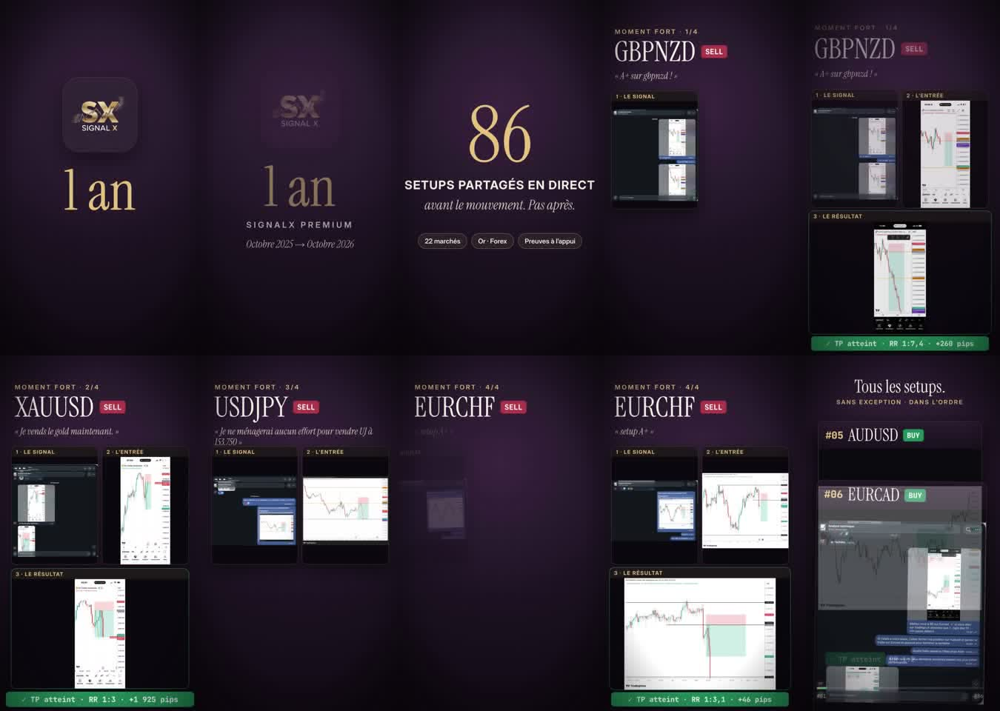
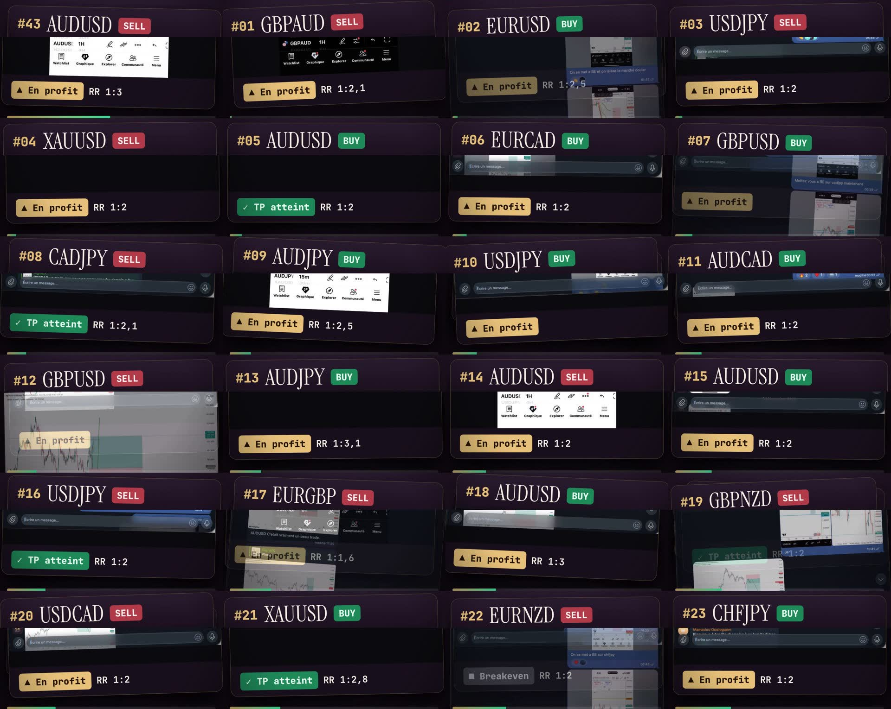

# La vidéo « SignalX — 1 an » (octobre 2025 → octobre 2026), vérifiée

*17/10/2026. Vidéo promotionnelle de 90 s transmise par l'utilisateur (`SignalX-1an-promo.mp4`, 71 Mo, non suivie par Git). Elle n'a pas de voix, seulement de la musique : tout le message est dans le texte affiché. Les 86 cartes ont été relues image par image (OCR puis contrôle visuel) : [`data/signalx_video_1an/cartes.csv`](../data/signalx_video_1an/cartes.csv). Planches : `assets/trades/2026-10/video_signalx_1an_*.jpg`.*

## 1. Ce que dit la vidéo
- « **1 an** — SignalX Premium — octobre 2025 → octobre 2026 ».
- « **86 setups partagés en direct, avant le mouvement. Pas après.** » — « 22 marchés », « Or · Forex », « Preuves à l'appui ».
- Quatre « moments forts » :

  | Moment fort | Résultat affiché |
  |---|---|
  | GBPNZD vente (« A+ sur gbpnzd ! ») | TP, **RR 1:7,4, +260 pips** |
  | Or vente (« Je vends le gold maintenant ») | TP, RR 1:3, +1 925 pips |
  | USDJPY vente (« Je ne ménagerai aucun effort pour vendre UJ à 153.750 ») | **aucun résultat montré** |
  | EURCHF vente (« setup A+ ») | TP, RR 1:3,1, +46 pips |

- « **Tous les setups. Sans exception. Dans l'ordre.** » — 86 cartes numérotées de #01 à #86.
- Offre : 39 000 F par mois, ramenés à **29 000 F** (−25 % jusqu'au 31 octobre) ; 3 mois à 97 000 F ; 6 mois à 175 000 F. Inscription par le bot Telegram ou WhatsApp. En petit en bas : « Les performances passées ne garantissent pas les résultats futurs ».

## 2. Le bilan affiché : 86 setups, aucune perte

| Statut affiché | Cartes |
|---|---|
| ✓ TP atteint | 36 |
| ▲ « En profit » | **48** |
| Breakeven | 1 (#22 EURNZD) |
| Signal publié | 1 (#83 USDJPY) |
| **Stop touché** | **0** |

- **Plus de la moitié des cartes (48 sur 86) ne montrent pas un résultat, mais une position « en profit » au moment de la capture.** Un gain flottant n'est pas un TP : la position a pu revenir au stop ensuite. Compter ces 48 cartes comme des réussites revient à afficher un taux de réussite proche de 100 %.
- Le ratio affiché est presque toujours de 1:2. Avec un tel ratio, même une excellente stratégie perd un trade sur trois ou quatre.

## 3. Des pertes reconnues par Amirou, absentes de la liste « sans exception »

La veille du premier exemple, Amirou écrit : « tous nos trades sont partagés dans le groupe de signaux » (#14221, 11/12/2025). Pourtant, au moins deux pertes qu'il a lui-même annoncées dans le canal manquent à la liste.

**GBPAUD achat du 12/12/2025.**
- Le trade est publié à 02h06 : « Setup A+ sur gbpaud » (#14224). Achat à 2,00970, stop 2,00447, objectif 2,01750.
- Il écrit à 09h54 : « **Un excellent setup ! Mais terminé en SL.** » (#14225), puis à 16h22 : « Ça fait mal hein » (#14226).
- Les cours horaires confirment le stop, touché à 08h00.
- Dans la vidéo, la carte #24 est bien un GBPAUD achat, mais **celui de la veille** (11/12) : entrée 2,00597, stop 2,00194, objectif 2,01431, gagnant. La carte suivante (#25) est un achat d'or. Le trade du 12/12, perdant, n'apparaît nulle part.
- Captures : [plan du 12/12](../assets/trades/2025-12/msg14224_gbpaud_setup_a_plus.jpg) ; [carte #24 de la vidéo](../assets/trades/2026-10/video_signalx_1an_carte24_gbpaud.jpg).

**USDJPY du 01/10/2026.**
- La carte #83 est la vente USDJPY du 30/09 (157,511 / 157,869 / 156,459). Elle correspond exactement au plan du canal.
- Le 01/10 à 00h39, Amirou écrit : « usdjpy nous a fait du mal hein, **toucher notre sl** et partir direct au tp » (#15505), avec la capture TradingView du trade (#15504).
- La carte suivante (#84) est l'EURCHF du 01/10 à 11h19. Le USDJPY perdant n'est pas dans la liste.

**D'autres stops qu'il a reconnus dans le canal sur la même période** n'ont pas été rapprochés un par un des cartes, faute de date lisible sur chacune :
- « On a eu sl sur usdjpy » (#14002, 02/10/2025) ;
- GBPUSD (#14386, 29/01/2026) ;
- « EURCAD a touché SL » (#14611, 20/03/2026) ;
- « on a touché un SL sur cadchf » (#14691, 09/04/2026) ;
- « SL sur eurnzd » (#15144, 21/07/2026).

Une vidéo qui en contient zéro sur 86 cartes est donc incomplète, ou classe ces trades en « En profit » ou « Breakeven ».

**Ce que montrent les cours pour le canal gratuit, sur la même période** (`analyses/TRADES_TOUS_LES_MOIS.md`) : 78 plans publiés avant l'entrée ; 26 objectifs atteints, **27 stops** et 25 ordres jamais déclenchés.

## 4. Les « moments forts »
- **GBPNZD, « RR 1:7,4, +260 pips »**.
  - Dans le canal gratuit, le plan est publié **après coup**, le 28/05/2026 à 15h10 (#14896) : vente à 2,27499, stop 2,27846 (35 pips), **objectif 2,26391, soit 3,2 R et 111 pips**.
  - Le prix est bien descendu jusqu'à 2,2440 le 29/05, ce qui laisse les 260 pips possibles.
  - Mais 1:7,4 suppose un objectif à environ 2,2490, plus de deux fois plus loin que celui publié. Soit l'objectif était différent sur SignalX, soit il a été repoussé après coup, comme pour le GBPJPY « 1:5 » du 14/10 (voir `analyses/OCTOBRE_2026.md`).
- **EURCHF, « RR 1:3,1, +46 pips »**.
  - Il s'agit du plan du 01/10/2026 à 11h19 (#15514) : vente à 0,94465, stop 0,94615, objectif 0,94003. Il est annoncé avec « ce setup a 95 % de probabilité » (#15515).
  - Le prix a touché 0,94479 dans l'heure de publication, puis 0,9320 l'après-midi. Le trade est **plausible** : notre rejeu, qui commence à l'heure suivant la publication par prudence, le classait « non déclenché ».
- **Or, +1 925 pips** et **USDJPY à 153,750** : ces messages ne sont pas dans le canal gratuit, seulement sur SignalX ; ils sont donc invérifiables ici. Pour le USDJPY, la vidéo ne montre d'ailleurs aucun résultat.

## 5. « Avant le mouvement. Pas après. »
Cette promesse ne peut pas être vérifiée pour le groupe SignalX, auquel nous n'avons pas accès. Dans le canal gratuit, en revanche, les trades SignalX sont souvent republiés **après** le mouvement : 67 plans « après coup » contre 78 annoncés sur la période (`analyses/TRADES_TOUS_LES_MOIS.md`). En octobre 2026, huit plans sur onze étaient montrés après coup (`analyses/OCTOBRE_2026.md`).

## 5 bis. Le jour de la publication
La vidéo est publiée dans le canal le 16/10/2026 (#15667) : « SignalX a 1 an 🎉 86 setups A+ partagés en direct, tous dans la vidéo ». Dans les deux jours précédents, trois plans annoncés dans le canal ont touché leur stop selon les cours, sans que le canal le signale : EURUSD #15631, EURJPY #15649, EURUSD #15664 (`analyses/OCTOBRE_2026.md`).

## 6. En résumé
- La vidéo montre **86 setups et aucune perte**. Mais **48 d'entre eux sont seulement « en profit »**, sans résultat final.
- **Au moins deux pertes reconnues par Amirou lui-même**, le GBPAUD « A+ » du 12/12/2025 et le USDJPY du 01/10/2026, manquent à une liste présentée comme complète, « sans exception, dans l'ordre ». La vidéo est donc trompeuse dans sa présentation.
- Un moment fort (GBPNZD à 1:7,4) affiche un ratio plus de deux fois supérieur au plan publié dans le canal.
- Pour juger SignalX honnêtement, il faudrait la liste réelle des 86 signaux avec leur heure d'envoi, leur stop, leur objectif et leur résultat final, y compris les pertes. Ou mieux, un relevé de compte vérifié.
